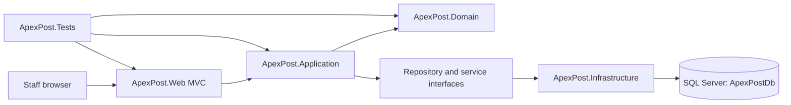
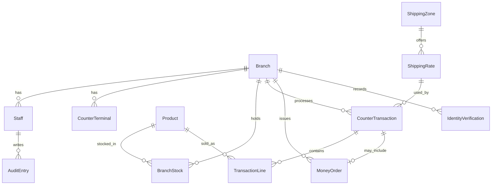
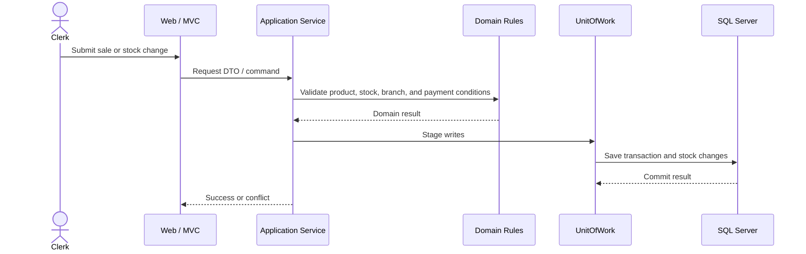

# Design overview

## Architecture

The solution uses a layered architecture tuned for the SQL Server / EF Core Week 3 assignment:

    ApexPost.Web -> ApexPost.Application -> ApexPost.Domain
    ApexPost.Web -> ApexPost.Infrastructure -> ApexPost.Application
    ApexPost.Infrastructure -> ApexPost.Domain
    ApexPost.Tests -> projects under test

The Web layer remains the composition root. Application services define the contract. Domain owns invariants. Infrastructure implements repository interfaces, EF Core mappings, and SQL-specific operations such as stored procedures and query projections.



## SQL Server model

The database is branch-centric and normalized around stock, sales, shipping, money orders, and operational auditing. SQL Server is the system of record, and EF Core maps the model without making the domain aware of the storage engine.



## Normalization notes

This design follows a normalized relational model and avoids the classic update anomalies that make file-based storage difficult to scale.

## SQL Server data layer (Assignment 3)

The Assignment 3 persistence work keeps the domain and application contracts stable while moving the persistence implementation behind EF Core and SQL Server. The `ApexPostDbContext` maps the normalized relational model for branches, staff, products, stock, shipments, money orders, identity verification, counters, payments, and audit records. Migrations are produced in `ApexPost.Infrastructure/Data/Migrations`, and the repository abstraction remains the boundary that the application code depends on.

The generated schema script is checked in under `sql/ApexPostDb_schema.sql` and can be regenerated with:

```bash
dotnet ef migrations script --idempotent --project ApexPost.Infrastructure --startup-project ApexPost.Web --output sql/ApexPostDb_schema.sql
```

This design keeps the `DbContext` and repository implementation scoped, uses shadow/audit metadata and rowversion concurrency columns, and separates persistence concerns from rich domain behavior.

## Middleware and MVC filters

The application continues to use MVC filters and middleware for request timing, auditing, security, antiforgery, and exception handling. These remain at the web boundary, while the domain and infrastructure layers own the operational rules and storage details.

1. Product duplication anomaly prevention
   - Product details are stored once in the product table and referenced from branch stock and transaction lines.
2. Branch stock drift prevention
   - Branch stock is managed in a single branch-stock record with separate stock-adjustment history rows to keep inventory balance and movement history consistent.
3. Transaction and reporting integrity
   - Transaction lines snapshot the product, pricing, and service state at the time a sale is recorded so later master-data changes do not rewrite historical receipt facts.

## Delete behavior and constraints

The schema uses explicit foreign keys and a clear delete strategy:

- branch records are retained as durable operational data and not deleted casually
- child rows such as staff, stock, transactions, and audit entries are removed with explicit business rules
- the database uses check constraints for non-negative stock, positive money values, valid status transitions, and weight limits
- UNIQUE constraints cover branch codes, product SKUs, and staff email values
- rowversion and audit columns are maintained on the writable transactional tables

## SQL Server execution model

Read paths are projection-based and use `AsNoTracking`, while write paths go through services and the unit of work. Procedures are used only where the database operation is naturally set-based or transactional:

- `usp_DailyBranchSales`
- `usp_LowStockReport`
- `usp_AdjustStock`

The implementation keeps a single data-access boundary and does not expose `IQueryable` outside the infrastructure layer.

## Architecture decisions

The repo records the accepted SQL Server decisions in `docs/adr/`.

Key ADRs:

- 0033: SQL Server persistence
- 0034: Relational schema design
- 0035: Stored procedures for reports and stock adjustments
- 0036: Index optimization and execution-plan evidence
- 0037: Local SQL Server runtime validation
- 0038: Repository and Unit of Work boundaries
- 0039: Domain vs persistence, audit strategy, and stock concurrency
- 0040: Final assignment-compliance evidence

The repository also includes a direct rubric-tracking file at `docs/ASSIGNMENT-3-RUBRIC-CHECKLIST.md`, which maps the final assignment brief to specific evidence in the repo and calls out the remaining environmental limitation for remote GitHub operations.

## SOLID and layering mapping

- Single Responsibility: repositories own persistence behavior, services own business use cases, controllers own HTTP concerns
- Open/Closed: application interfaces allow alternate data providers without changing business logic
- Liskov: repositories and unit-of-work implementations are substitutable behind the same contract
- Interface Segregation: repositories are specialized to aggregates rather than a single giant abstraction
- Dependency Inversion: Web depends on Application interfaces, and Infrastructure implements them

## Data flow



## Summary

This design intentionally uses SQL Server as the system of record for the Week 3 assignment, keeps the business logic stable, and moves the persistence implementation behind the existing application interfaces without using Couchbase or a second database model.
See docs/adr/ for accepted architecture decision records, including explicit alternatives in the core architecture, persistence, audit, security, filter, and logging decisions. ADR 0028 documents trusted forwarded headers. The domain, middleware, filter, security, audit, performance, and SOLID notes above describe the current implementation and its known limitations.

## Week 3 SQL Server persistence foundation

The Week 3 SQL Server schema, EF Core mapping decisions, migration commands, and data relationships are documented in [docs/week3-sqlserver.md](docs/week3-sqlserver.md). That page describes the current persistence foundation and clearly marks the remaining JSON-to-EF repository migration work.
