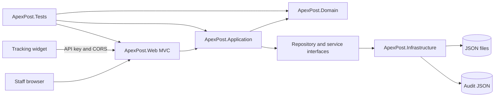
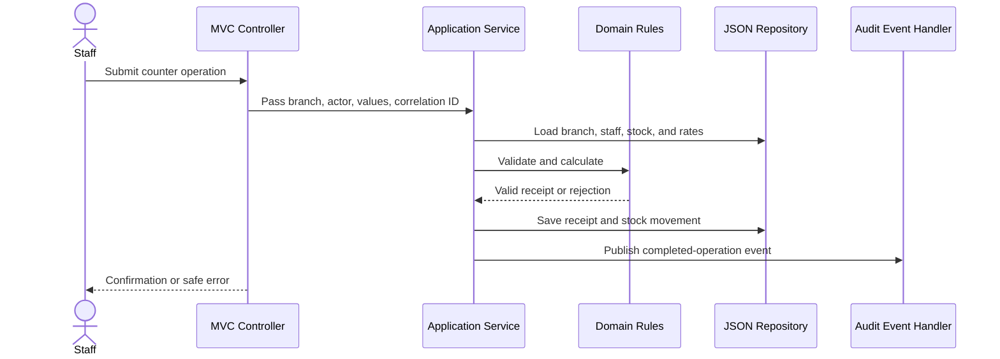

# Design overview

## Architecture

The solution uses a layered design with dependencies pointing toward the domain:

    ApexPost.Web -> ApexPost.Application -> ApexPost.Domain
    ApexPost.Web -> ApexPost.Infrastructure -> ApexPost.Application
    ApexPost.Infrastructure -> ApexPost.Domain
    ApexPost.Tests -> projects under test

MVC controllers translate HTTP input into application use cases and responses. Business rules belong in Domain and Application code. Infrastructure implements repository and integration interfaces.



## Middleware and MVC filters

The HTTP pipeline is ordered as follows so cross-cutting checks happen before endpoint execution:

```text
Correlation ID
  -> Exception logging
  -> Security headers
  -> Maintenance gate (/health bypass)
  -> HTTPS redirection
  -> Routing
  -> Endpoint CORS
  -> Rate limiter
  -> Admin IP restriction / partner API key
  -> Authentication
  -> Authorization
  -> MVC or partner endpoint
```

Middleware handles concerns that apply to the HTTP request regardless of which MVC action runs: correlation, error logging, headers, maintenance, CORS, rate limits, IP checks, and partner keys. MVC action filters run around controller actions and are used for slow-action timing and auditing successful configuration changes. Domain and Application services remain responsible for business rules; filters do not decide whether a stock change, sale, or refund is valid.

## Domain flow



## Staff authentication slice

- Staff and branch records are modeled in Domain.
- Application authentication checks credentials, rejects inactive staff, and resolves assigned branch context.
- Infrastructure persists branches and staff in JSON files under the root data directory.
- Passwords are hashed with ASP.NET Core's PasswordHasher; plaintext demo passwords are not written to JSON.
- The MVC host uses secure cookie authentication, a fallback authenticated-user policy, and antiforgery validation for unsafe MVC actions. Development uses ephemeral data-protection keys; production must configure durable protected keys for multi-instance deployments.
- Role, staff ID, and assigned branch are emitted as claims after successful authentication.

## Branch and staff administration slice

The Administrator-only MVC area lists branches and staff, creates branches with local opening/closing times, manages branch terminals, creates staff accounts, and activates or deactivates staff accounts. `AdministrationController` handles web forms and authorization. `StaffManagementService` checks duplicate branch codes, terminal codes, and email addresses, validates branch assignment, delegates password hashing, and prevents deactivating the last active Administrator. Each sale must use an active terminal assigned to its branch, and the terminal ID is retained on the receipt. Terminals are stored behind `ICounterTerminalRepository` in `counter-terminals.json`. The service depends on Application repository abstractions; Infrastructure provides the JSON-backed implementations. This JSON read-modify-write workflow is intended for the single-process training application and does not provide transactional multi-user concurrency guarantees.

## Product catalogue slice

`Product` owns SKU and price invariants. `ProductCatalogueService` searches the repository and handles create/activation operations. `CatalogController` makes catalogue browsing available to signed-in staff and restricts product changes to Administrators and Branch Managers. The repository abstraction is implemented by Infrastructure using `data/products.json`; the development seeder supplies 30 products when no product data exists. Prices are stored as decimal amounts with two fractional digits and displayed as INR in the MVC view. Inventory quantities and stock movements belong to a later feature and are not part of this catalogue record.

## Inventory slice

`InventoryItem` is scoped to one branch and product. It stores quantity on hand, a reorder level, and its stock movement history together so each update is written through one JSON collection replacement. `InventoryManagementService` joins active catalogue products with branch stock, validates branch/product state, prevents negative stock, and appends the signed-in staff member and reason to each movement. `InventoryController` lets signed-in staff view only their assigned branch; Administrators can select a branch, and only Administrators and Branch Managers can change stock. The JSON repository is suitable for this single-process training application and does not provide multi-process transaction guarantees.

## Shipping rates slice

`ShippingZone` models a destination group, while `ShippingRate` defines the service level, base charge, per-kilogram charge, and maximum supported weight. The Domain rate calculates a quote and enforces non-negative two-decimal prices and configured weight limits. `ShippingRateService` coordinates zone/rate repositories, prevents duplicate zone codes and duplicate service levels within a zone, and calculates quotes. Counter shipments save recipient name, destination address, weight, and three positive dimensions with the receipt snapshot. The label preview checks that the receipt belongs to the caller's branch and renders printable shipping metadata without exposing unrelated branch data. Infrastructure stores the two collections separately and development seeding creates 10 zones with Standard and Express rates. `ShippingController` allows all signed-in staff to view and quote; only Administrators can add zones and rates.

## Counter transactions slice

`CounterTransaction` stores a completed receipt with terminal ID, line-item price, tax category, tax rate, and tax amount snapshots, optional shipping quote and shipping tax details, payment method, branch, staff member, and timestamp. A basket can combine products and a parcel shipping service. Configured tax category rates are applied at checkout; unconfigured categories fail closed. The demo configuration uses 0% Standard and Shipping rates until approved rates are supplied. `CounterTransactionService` checks branch/product/terminal availability, calculates shipping using the existing service, deducts stock with a linked inventory movement, and persists the receipt. `CounterTransactionsController` enforces branch scope from the authenticated claims and allows Clerks, Managers, and Administrators to create transactions; Auditors can review. The training JSON implementation writes inventory and receipt collections separately, so it does not provide a cross-file database transaction or external payment settlement.

Branch Managers can void or fully refund a completed counter transaction at their assigned open branch. The domain transition requires a non-empty reason, records the manager and timestamp, and prevents a second reversal. The application service checks the live staff record and branch assignment, restores the product quantities, changes the stored transaction status, and publishes an audit event. Managers can also refund an issued money order once; the order records its refund actor/time/reason and an event is written to the audit log. Partial counter-transaction refunds are not supported. Since the JSON adapter has no cross-file transaction, the receipt service compensates a failed inventory write by restoring the original receipt status; money order status and audit persistence remain separate file operations.

## Branch reports and demo history

`ReportingService` concurrently reads branch, sales, inventory, catalogue, money-order, identity-verification, and audit collections using `Task.WhenAll`. It filters every measure by branch and calculates completed sales, low-stock active products, completed shipping volume by zone and service, money-order totals, failed identity checks, reversals, and the 50 newest audit events. Administrators can select a branch; Branch Managers and Auditors are constrained to their assigned branch in the controller. Development seeding creates 40 deterministic historical transactions and matching opening stock movements when transaction and inventory collections are both empty.

## Money orders and identity verification

`MoneyOrderService` verifies that the branch is open and the current staff record is active, authorized, and assigned to the selected branch before issuing an order. The configured flat fee is added to the order amount. When the amount exceeds the configured threshold, the service calls `IIdentityVerificationService`, stores a verification attempt with a masked identifier and result, and issues the money order only for a successful result. The order stores a reference to that verification record. Development uses a simulated adapter that accepts only synthetic identifiers with the configured `DEMO-VALID-` prefix; other environments fail closed until a real provider is configured. Money orders and verification attempts use separate JSON repositories, so they do not have cross-file transaction guarantees.

## Persistence

Assignment 2 requires JSON file persistence behind interfaces. The JSON implementation remains in Infrastructure so a later database adapter can replace it without changing business rules. JSON writes use a semaphore and a temporary file replacement; this protects a single process from overlapping writes but does not provide multi-process transactions.

## Security and audit

Cookie authentication, server-side role and branch checks, antiforgery validation, correlation IDs, request exception logging, security headers, maintenance mode, IP restrictions, rate limiting, partner API keys, and a restricted tracking-widget CORS policy are in place. Middleware order is: correlation ID; exception logging; security headers; maintenance gate; HTTPS redirection; routing; endpoint CORS; rate limiter; admin IP and partner API-key checks; authentication; authorization; endpoints. `/health` is anonymous and remains available during maintenance.

MVC action filters log slow actions and audit successful branch status/hours, terminal, staff, catalogue, inventory, and shipping configuration changes. Sales, money-order issuance, and reversals publish application events that Infrastructure handlers append to `audit-records.json`. Audit failure is logged without making a committed operation appear unsuccessful; JSON audit storage therefore has an acknowledged consistency gap. Sensitive identity values are used transiently by the simulated verifier and masked before persistence. Partner API keys are supplied through secret configuration and compared in constant time. The default admin allowlist is loopback-only; deployments behind proxies must configure trusted forwarded headers before IP restrictions can identify the original client.

## SOLID mapping and advanced C# usage

| Principle or feature | ApexPost example | Reason |
|---|---|---|
| Single Responsibility | Controllers bind HTTP input; Application services coordinate use cases; Infrastructure owns JSON storage | Each layer has one reason to change. |
| Open/Closed | `IInventoryRepository`, `ICounterTransactionRepository`, and `IIdentityVerificationService` | A database or provider adapter can be substituted without rewriting business rules. |
| Liskov Substitution | JSON adapters and test doubles implement the same repository contracts | Callers depend on behavior expressed by the interface, not concrete storage. |
| Interface Segregation | Separate branch, staff, inventory, shipping, and transaction repository interfaces | Consumers receive only the operations they use. |
| Dependency Inversion | Application services accept repository and publisher abstractions | High-level business workflows do not depend on JSON implementation details. |
| Records | Domain entities, request events, report models, and audit records | Immutable snapshots make business state and event data explicit. |
| Pattern matching | Enum `switch` expressions and `is`/`is not` checks in workflow validation | Branching rules stay readable and exhaustive. |
| Generics | `JsonCollectionStore<T>` and `IApplicationEventHandler<T>` | Shared persistence and event dispatch avoid duplicated type-specific plumbing. |
| Delegates and `Func` | `LowStockRule` accepts a `Func<int, int, bool>` predicate used by branch reporting | The low-stock comparison is an explicit policy that can be replaced and tested without rewriting report orchestration. |
| Events and observers | Counter completion, money-order issuance, and reversal events | Audit observers are decoupled from the business operation. |
| Async and cancellation | Repository contracts accept `CancellationToken` and use asynchronous file I/O | Request cancellation can flow through the storage boundary. |
| `Task.WhenAll` | `ReportingService` loads independent branch report collections concurrently | The report waits on the slowest read rather than serializing unrelated reads. |
| `SemaphoreSlim` | JSON collection writes and audit appends | A single process serializes writes to each shared JSON collection. |

The implementation uses eight requested C# techniques: records, pattern matching, generics, delegates/`Func`, events, async/cancellation, `Task.WhenAll`, and `SemaphoreSlim`. `ValueTask`, cache layers, custom-attribute reflection, extension members, and a `Money`/`Weight` value-object hierarchy are not used because the current workload does not justify their complexity.

## Decisions

See docs/adr/ for accepted architecture decision records. The domain, middleware, filter, security, audit, performance, and SOLID notes above describe the current implementation and its known limitations.
