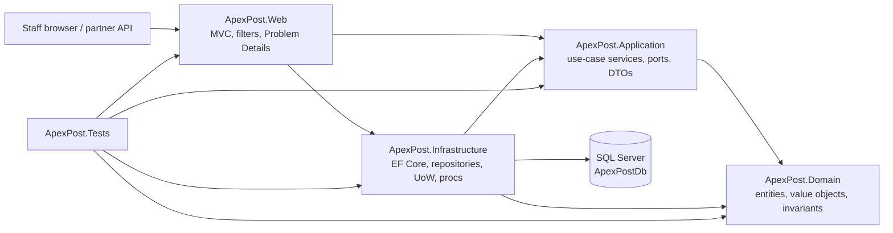
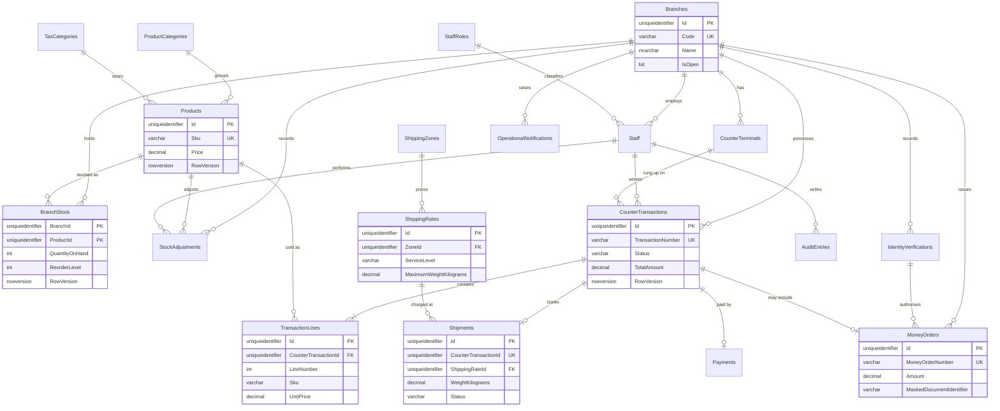

# Design overview - ApexPost (Week 3: SQL Server + EF Core 10)

SQL Server is the system of record. EF Core 10 maps the schema; three stored procedures cover the set-based
operations; the domain model does not know about either. The JSON adapter from Weeks 1-2 is still available
(`Persistence:Provider = Json`) for offline demos and for the legacy reliability tests.

## 1. Architecture and layers



| Layer | Owns | Must not |
|---|---|---|
| Domain | `Product`, `InventoryItem`, `CounterTransaction`, `MoneyOrder`, value objects (`Sku`, `BranchCode`, `Money`, `Weight`, `IdentityDocumentMask`, ...) and their invariants | reference EF Core, SQL or HTTP |
| Application | use-case services, repository / UoW / query ports (`IUnitOfWork`, `IReportingQueries`, `IStoredProcedureService`, `IAuditStore`), DTOs and persistence exceptions | expose `IQueryable` or `DbContext` |
| Infrastructure | `ApexPostDbContext`, `IEntityTypeConfiguration<T>` classes, value converters, shadow audit columns, `EfUnitOfWork`, repositories, read-side query services, procedure calls, migrations | contain business rules |
| Web | controllers (HTTP only), view models with `[Bind]`, Problem Details mapping, audit filter, composition root | call `DbContext` directly |

The write path for a sale (Part F / G):

```mermaid
sequenceDiagram
    actor Clerk
    participant C as CounterTransactionsController
    participant S as CounterTransactionService
    participant D as Domain (CounterTransaction, InventoryItem)
    participant U as EfUnitOfWork
    participant R as Repositories (stage only)
    participant DB as SQL Server
    Clerk->>C: POST /CounterTransactions/Create (view model, [Bind])
    C->>S: CompleteSaleAsync(request DTO)
    S->>U: ExecuteInTransactionAsync(...)
    U->>DB: BEGIN TRAN (READ COMMITTED, inside execution strategy)
    S->>R: GetForBranchAsync (tracked, remembers rowversion)
    S->>D: Reserve stock, build receipt (invariants)
    S->>R: UpdateAsync(stock) + AddAsync(transaction graph)
    U->>DB: ONE SaveChanges: UPDATE BranchStock ... WHERE RowVersion = @original; INSERT header, lines, payment, shipment
    alt rowversion changed
        DB-->>U: 0 rows -> DbUpdateConcurrencyException
        U-->>C: ConcurrencyConflictException -> HTTP 409 + Conflict view
    else ok
        U->>DB: COMMIT
        C->>C: IAuditStore.WriteAsync (own context, after commit)
    end
```

## 2. Relational model (ER diagram)



Twenty tables, all created by EF Core migrations. The idempotent script is `sql/ApexPostDb_schema.sql`.
Constraint list and reasons: [ADR 0041](docs/adr/0041-schema-design-and-delete-behaviours.md). Every
constraint can be listed from the catalog with `sql/assignment3-compliance.sql`.

- **PK**: surrogate `uniqueidentifier` keys; composite `(BranchId, ProductId)` for `BranchStock`.
- **UNIQUE**: branch code, SKU, staff e-mail, zone code, `(ZoneId, ServiceLevel)`, `(BranchId, Code)` for terminals,
  transaction number, money-order number, `(CounterTransactionId, LineNumber)`, and one payment / shipment per transaction.
- **CHECK**: quantity on hand >= 0, amounts > 0, totals >= 0, allowed `Status` values, weight in (0, 30] kg,
  reversal consistency, letters have no dimensions, identity documents stored masked only (`LIKE '****%'`).
- **DEFAULT**: `CreatedAtUtc = SYSUTCDATETIME()`, `Shipments.Status = 'Booked'`, notification and outbox counters.
- **rowversion**: `BranchStock`, `CounterTransactions`, `Products`.

### Normalization (3NF) - three anomalies the schema prevents

1. **Update anomaly - product data copied into stock rows.** If a product's name and price were stored on each
   `BranchStock` row, a price change would have to update every branch, and a missed row would make two branches
   charge different prices for the same SKU. Product facts live once in `Products`; `BranchStock` holds only
   `(BranchId, ProductId, QuantityOnHand, ReorderLevel)`.
2. **Transitive dependency - shipping zone inside the transaction.** Week 2 stored the zone name and service
   level on each transaction. Those depend on the shipping rate, not on the transaction
   (`TransactionId -> RateId -> ZoneName`). Renaming a zone would leave old rows inconsistent. Week 3 moves
   shipments into `Shipments` with a FK to `ShippingRates`; migration `Week3SchemaCompliance` moves the existing rows.
3. **Insert/delete anomaly - stock movements only as a running total.** With only a quantity column, you cannot
   record *why* stock changed, and deleting a sale would lose the movement. `StockAdjustments` is an append-only
   history (reason, staff, signed quantity, CHECK `<> 0`); `BranchStock.QuantityOnHand` is the current balance,
   changed in the same transaction (`usp_AdjustStock`).

Deliberate snapshots (not denormalisation): `TransactionLines` keep `Sku`, `UnitPrice`, tax rate and tax amount
as they were at the time of sale. A receipt is a legal record, so a later price change must not rewrite it.

### Delete behaviours

| Relationship | ON DELETE | Why |
|---|---|---|
| CounterTransactions -> TransactionLines / Payments / Shipments | CASCADE | Parts of one aggregate. |
| any -> Branches, Staff, Products, ShippingZones/Rates, StaffRoles, categories | NO ACTION (Restrict) | Master data is referenced by financial history; it is deactivated, not deleted. |
| MoneyOrders -> CounterTransactions / IdentityVerifications | NO ACTION | A money order must keep its receipt and verification. |
| AuditEntries, StockAdjustments, OperationalNotifications | NO ACTION, plus DENY DELETE for the app role | Append-only history (`sql/least-privilege.sql`). |

## 3. Data access rules

- **One `SaveChanges` per use case.** Repositories only stage changes. `EfUnitOfWork.ExecuteInTransactionAsync`
  runs the use case inside the execution strategy (retry on transient faults), opens one READ COMMITTED
  transaction, saves once and commits. A nested call joins the outer transaction. ([ADR 0044](docs/adr/0044-repository-unit-of-work-and-query-services.md))
- **No `IQueryable` leaves Infrastructure.** Repositories return domain objects; reports return DTO rows from
  `IReportingQueries` (`AsNoTracking` projections, or a procedure). ([ADR 0048](docs/adr/0048-dtos-mapping-and-query-command-separation.md))
- **Optimistic concurrency** on `BranchStock` and `CounterTransactions` via `rowversion`. A conflict becomes
  `ConcurrencyConflictException`, then HTTP 409. ([ADR 0046](docs/adr/0046-concurrency-strategy.md))
- **Raw SQL is parameterised.** `SqlQuery`/`ExecuteSql` take interpolated strings (converted to parameters);
  there is no string concatenation into SQL.
- **N+1 avoided.** The transaction list uses `Include` + `AsSplitQuery`, and an integration test checks the command
  count stays at 5 or fewer. Generated SQL samples: [docs/generated-sql-samples.md](docs/generated-sql-samples.md).
- **Stored procedures** (`usp_DailyBranchSales`, `usp_LowStockReport`, `usp_AdjustStock`) are created by the
  `Week3SchemaCompliance` migration and called through `IStoredProcedureService`. ([ADR 0043](docs/adr/0043-stored-procedures-and-why.md))
- **Audit store** has its own `DbContext`, so an audit row is written even when the business transaction rolls back.
  ([ADR 0047](docs/adr/0047-audit-store-and-unit-of-work.md))
- **Domain vs persistence.** `SqlRows.cs` row classes are separate from domain entities. Audit columns and
  `RowVersion` are shadow properties, set by `AuditColumnsInterceptor`. ([ADR 0045](docs/adr/0045-domain-vs-persistence-models.md))

## 4. Errors at the HTTP boundary

`SafeProblemDetailsExceptionHandler` maps exceptions to RFC 7807 responses, without stack traces or SQL text:

| Exception | Status |
|---|---|
| `ConcurrencyConflictException`, `DuplicateResourceException` (SQL 2601/2627) | 409 Conflict |
| `KeyNotFoundException` (incl. procedure error 50004 "branch not found") | 404 Not Found |
| `ArgumentException` / `InvalidOperationException` raised by Domain or Application | 400 Bad Request |
| anything else (incl. raw `DbUpdateException`, `SqlException`) | 500, generic message, logged with correlation id |

MVC forms that hit a conflict show `Views/Shared/Conflict.cshtml` (409) and ask the clerk to reload.

## 5. Architecture decision records

Week 3 decisions (current):

| ADR | Decision |
|---|---|
| [0041](docs/adr/0041-schema-design-and-delete-behaviours.md) | Schema, constraints, delete behaviours |
| [0042](docs/adr/0042-index-choices-and-evidence.md) | Index choices, backed by measured plans |
| [0043](docs/adr/0043-stored-procedures-and-why.md) | Which operations are stored procedures, and why |
| [0044](docs/adr/0044-repository-unit-of-work-and-query-services.md) | Repository / Unit of Work boundaries; where direct projections are allowed |
| [0045](docs/adr/0045-domain-vs-persistence-models.md) | Domain vs persistence models, shadow properties |
| [0046](docs/adr/0046-concurrency-strategy.md) | Concurrency strategy (rowversion, isolation level, no RCSI) |
| [0047](docs/adr/0047-audit-store-and-unit-of-work.md) | Audit store and the unit of work |
| [0048](docs/adr/0048-dtos-mapping-and-query-command-separation.md) | DTOs, mapping, over-posting, query/command separation |

ADRs 0001-0032 record Weeks 1-2 decisions and still apply. ADRs 0033-0040 were first drafts of the SQL Server move
and are marked *Superseded* by 0041-0048.

## 6. SOLID in this codebase

- **S** - `CounterTransactionService` runs the sale use case; `EfCounterTransactionRepository` maps rows;
  `EfUnitOfWork` owns the transaction; controllers own HTTP.
- **O** - a new persistence provider means new `IUnitOfWork` / repository classes. Services do not change, which is
  how the JSON and SQL Server adapters coexist.
- **L** - `NoOpUnitOfWork` (JSON mode), `EfUnitOfWork` and the test `SpyUnitOfWork` are interchangeable. `SupportsAtomicCommit`
  tells services which commit path to use, instead of type checks.
- **I** - small ports (`IInventoryRepository`, `IReportingQueries`, `IStockAdjustmentCommand`, `IAuditStore`)
  instead of one generic repository.
- **D** - Web and Application depend on interfaces; `AddApexPostSqlServer` in Infrastructure binds them.
