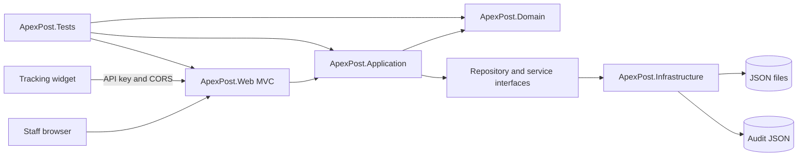
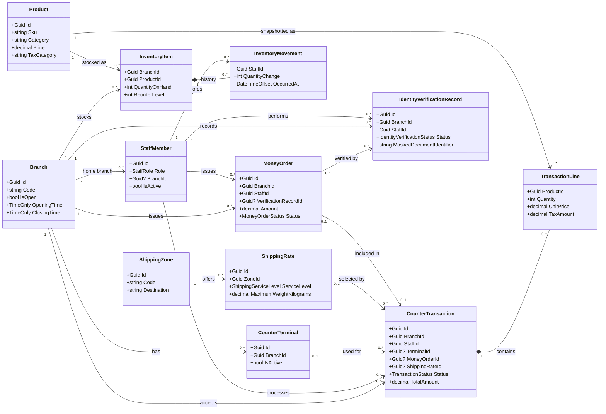
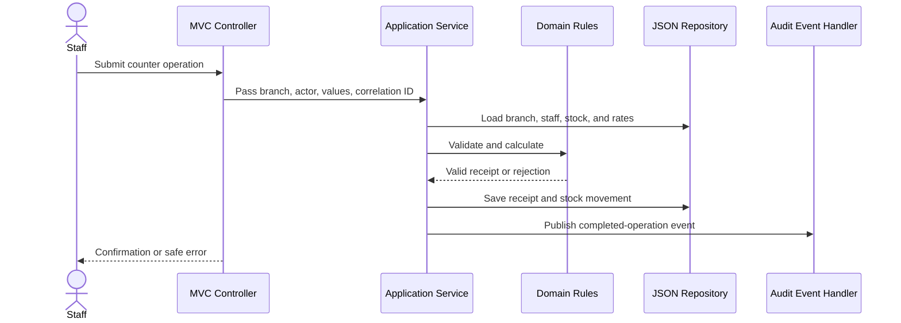

# Design overview

## Architecture

The solution uses a layered design with dependencies pointing toward the domain:

    ApexPost.Web -> ApexPost.Application -> ApexPost.Domain
    ApexPost.Web -> ApexPost.Infrastructure -> ApexPost.Application
    ApexPost.Infrastructure -> ApexPost.Domain
    ApexPost.Tests -> projects under test

MVC controllers translate HTTP input into application use cases and responses. Business rules belong in Domain and Application code. Infrastructure implements repository and integration interfaces.



The following domain diagram shows the main entities and their ID-based associations. The JSON records store identifiers rather than object navigation properties.



## Middleware and MVC filters

The HTTP pipeline is ordered as follows so cross-cutting checks happen before endpoint execution:

```text
Trusted forwarded headers
  -> Correlation ID
  -> Structured request logging and timing
  -> Global exception handler (Problem Details)
  -> HSTS (outside Development)
  -> Exception logging
  -> Security headers
  -> Maintenance gate (/health bypass)
  -> HTTPS redirection
  -> Routing
  -> Endpoint CORS
  -> Admin and integration IP allowlists
  -> Partner API key
  -> Rate limiter
  -> Authentication
  -> Authorization
  -> MVC or partner endpoint
```

Middleware handles concerns that apply to the HTTP request regardless of which MVC action runs: correlation, structured request timing, safe error responses, error logging, headers, maintenance, CORS, rate limits, IP checks, and partner keys. `RequestLoggingMiddleware` logs method, path, final status, and elapsed milliseconds in a `finally` block, so failed requests are timed too. It runs outside the global exception handler and shares the correlation ID logging scope. The exception handler emits an `application/problem+json` response with a safe message, trace ID, and correlation ID; it never serializes exception details. MVC action filters run around controller actions for model validation, slow-action timing, and auditing. Domain and Application services remain responsible for business rules; filters do not decide whether a stock change, sale, or refund is valid.

| Concern | Mechanism | Why |
|---|---|---|
| Correlation, request logging/timing, Problem Details exception handling, error logging, security headers, maintenance, CORS, rate limits, IP allowlists, partner keys | Middleware | These checks apply at the HTTP request boundary before MVC action selection or model binding. Request logging wraps the exception handler to capture its final status and total duration. The exception handler returns safe RFC-style problem responses with trace and correlation IDs; the partner key middleware sets a configured partner identity before the endpoint rate limiter partitions requests. |
| Antiforgery tokens | Built-in MVC filter | The check uses MVC form and endpoint metadata and applies to unsafe MVC actions. |
| Invalid model state | `ModelValidationActionFilter` | It runs after MVC model binding. JSON callers receive a consistent `400` validation problem; HTML forms retain the controller's correctly typed view and validation messages. |
| Audit of configuration and business actions | `MvcAuditActionFilter` | It needs controller/action identity, the authenticated staff principal, safe route keys, the MVC result, and action duration. Application events separately record committed sales, reversals, money-order issuance/refunds, and identity verification outcomes. |
| Slow-action warnings | `RequestTimingActionFilter` | It measures controller/action execution and reports an MVC action name with the elapsed duration. |

## Domain flow



## Staff authentication slice

- Staff and branch records are modeled in Domain.
- Application authentication checks credentials, rejects inactive staff, and resolves assigned branch context.
- Infrastructure persists branches and staff in JSON files under the root data directory.
- Passwords are hashed with ASP.NET Core's PasswordHasher; plaintext demo passwords are not written to JSON.
- The MVC host uses secure cookie authentication, a fallback authenticated-user policy, and antiforgery validation for unsafe MVC actions. Development uses ephemeral data-protection keys; production must configure durable protected keys for multi-instance deployments.
- Role, staff ID, and assigned branch are emitted as claims after successful authentication.

## Branch and staff administration slice

The Administrator-only MVC area lists branches and staff, creates branches with local opening/closing times, manages branch terminals, creates and edits staff accounts, and activates or deactivates staff accounts. `AdministrationController` handles web forms and authorization. `StaffManagementService` checks duplicate branch codes, terminal codes, and email addresses, validates branch assignment, delegates password hashing, and prevents deactivating or reassigning the last active Administrator. Staff profile edits preserve the existing password hash and staff ID. Each sale must use an active terminal assigned to its branch, and the terminal ID is retained on the receipt. Terminals are stored behind `ICounterTerminalRepository` in `counter-terminals.json`. The service depends on Application repository abstractions; Infrastructure provides the JSON-backed implementations. Staff and branch read-modify-write operations use the shared JSON mutation coordinator so multiple local processes do not replace each other's snapshots.

## Product catalogue slice

`Product` owns SKU and price invariants. `ProductCatalogueService` searches the repository and handles create/activation operations. `CatalogController` makes catalogue browsing available to signed-in staff and restricts product changes to Administrators and Branch Managers. The repository abstraction is implemented by Infrastructure using `data/products.json`; the development seeder supplies 30 products when no product data exists. Prices are stored as decimal amounts with two fractional digits and displayed as INR in the MVC view. Inventory quantities and stock movements belong to a later feature and are not part of this catalogue record.

## Inventory slice

`InventoryItem` is scoped to one branch and product. It stores quantity on hand, a reorder level, and its stock movement history together so each update is written through one JSON collection replacement. `InventoryManagementService` joins active catalogue products with branch stock, validates branch/product state, prevents negative stock, and appends the signed-in staff member and reason to each movement. `InventoryController` lets signed-in staff view only their assigned branch; Administrators can select a branch, and only Administrators and Branch Managers can change stock. Reads take a shared file lock; writes and service mutations take an exclusive lock, coordinating local application processes.

## Shipping rates slice

`ShippingZone` models a destination group, while `ShippingRate` defines the service level (Standard, Express, or Registered), base charge, per-kilogram charge, and maximum supported weight. The Domain rate calculates a quote and enforces non-negative two-decimal prices and configured weight limits. `ShippingRateService` coordinates zone/rate repositories, prevents duplicate zone codes and duplicate service levels within a zone, and calculates quotes. A parcel captures recipient name, destination address, weight, and three positive dimensions; a letter captures recipient, destination, and weight without parcel dimensions. Both use the configured rate and weight limit, and the shipment type and selected service are retained on the receipt and tracking response. The label preview checks that the receipt belongs to the caller's branch and renders printable shipping metadata without exposing unrelated branch data. Infrastructure stores the two collections separately and development seeding creates 10 zones with all three service levels, adding any missing Registered rates to existing seeded data. `ShippingController` allows all signed-in staff to view and quote; only Administrators can add zones and rates.

## Counter transactions slice

`CounterTransaction` stores a completed receipt with terminal ID, line-item price, tax category, tax rate, and tax amount snapshots, optional shipping quote and shipping tax details, optional money-order ID/principal/fee, payment method, branch, staff member, and timestamp. A basket can combine products, parcel shipping, and a money order; the money-order principal and configured fee contribute to the same receipt total. The money order still goes through `MoneyOrderService` identity checks and is linked to the receipt. Configured tax category rates are applied at checkout; unconfigured categories fail closed. The demo configuration uses 0% Standard and Shipping rates until approved rates are supplied. `CounterTransactionService` checks active staff and branch/product/terminal availability, calculates shipping using the existing service, deducts stock with a linked inventory movement, and persists the receipt. `CounterTransactionsController` enforces branch scope from the authenticated claims and allows Clerks, Managers, and Administrators to create transactions; Auditors can review. Inventory, receipt, money order, audit, and notification writes in one use case are staged and committed together by the JSON coordinator. This provides recoverable local file consistency, not database-level guarantees or external payment settlement.

Branch Managers can void or fully refund a completed counter transaction at their assigned open branch. The domain transition requires a non-empty reason, records the manager and timestamp, and prevents a second reversal. The application service checks the live staff record and branch assignment, restores the product quantities, changes the stored transaction status, and publishes an audit event. Managers can also refund an issued money order once; the order records its refund actor/time/reason and an event is written to the audit log. Partial counter-transaction refunds are not supported. Related JSON changes are committed as a recoverable unit; a failed operation leaves prior files intact or restores them during startup recovery.

## Branch reports and demo history

`ReportingService` concurrently reads branch, sales, inventory, catalogue, money-order, identity-verification, audit, and notification data using `Task.WhenAll`. It filters every measure by branch and calculates completed sales, daily retail/service sales, low-stock active products, completed shipping volume by zone and service, money-order totals, failed identity checks, reversals, the 20 newest operational notifications, and the 50 newest audit events. Daily summaries include completed receipts and standalone issued money orders, include associated tax, and group by the server's local calendar date. Catalogue lines in Postage, Shipping, and Money Order categories are classified as services; other catalogue lines are retail, while receipt shipping and money-order amounts also count as services. Linked money orders are not counted twice. Administrators can select a branch; Branch Managers are restricted to their assigned branch. Auditors have a separate cross-branch overview that aggregates the same report data without changing the branch-scoped report access. Development seeding creates 40 deterministic historical transactions and matching opening stock movements when transaction and inventory collections are both empty.

## Courier tracking adapter

`ICourierTrackingClient` keeps the partner endpoint independent of its data source. An empty `CourierTracking:ProviderBaseUrl` selects `SimulatedCourierTrackingClient`, which searches receipt snapshots using test latency. Setting a provider base URL selects `HttpCourierTrackingClient`: it sends an HTTPS GET to `{base}/{TrackingPath}/{escaped tracking number}`, supplies the secret through `X-API-Key`, maps 404 to no shipment, and parses the documented `ShipmentTrackingSummary` JSON contract. The response must echo the requested tracking number and contain valid service, shipment, zone, weight, status, and timestamp values. `CourierTracking:ApiKey` belongs in user-secrets or deployment secret configuration. Both implementations enforce the configured `SemaphoreSlim` concurrency limit and timeout; caller cancellation remains distinct from an internal timeout. The benchmark covers only synthetic simulator delay, not an external provider.

## Simulated operational notifications

Application events signal a stock transition from above the reorder threshold to below it, a money order whose principal exceeds the configured identity-verification threshold, and every counter-transaction void or refund. Standalone money-order refunds also emit a notification; a money order refunded as part of a counter receipt is represented by the receipt reversal notification to avoid duplicate alerts. `OperationalNotificationHandler` observes these events and appends branch-scoped records to `notifications.json`. Persistence failures are logged and do not turn an already committed sale or refund into a failed response. The branch report shows the 20 most recent records with time, type, message, and correlation ID. This is a simulated in-app record; no external notification provider is called.

## Money orders and identity verification

`MoneyOrderService` verifies that the branch is open and the current staff record is active, authorized, and assigned to the selected branch before issuing an order. The configured flat fee is added to the order amount. When the amount exceeds the configured threshold, the service calls `IIdentityVerificationService`, stores a verification attempt with a masked identifier and result, and issues the money order only for a successful result. The order stores a reference to that verification record. Development uses a simulated adapter that accepts only synthetic identifiers with the configured `DEMO-VALID-` prefix; other environments fail closed until a real provider is configured. Related money order, verification, receipt, inventory, and audit writes are included in the same recoverable local JSON mutation when they are part of one use case.

## Persistence

Assignment 2 requires JSON file persistence behind interfaces. The JSON implementation remains in Infrastructure so a later database adapter can replace it without changing business rules. `JsonMutationCoordinator` uses a shared file lock for reads and an exclusive OS file lock for writes, including cross-process read/modify/write workflows. Multi-file mutations stage replacement JSON files and original-file backups in `.apexpost-transaction`, write a prepared journal, replace the affected collections, and record a committed state. Startup recovery restores backups when a process stopped during a prepared commit, or clears completed transaction artifacts. Reads wait until the exclusive commit finishes so they do not observe a partially replaced group. Individual file replacements use temporary files and same-directory rename. This mechanism assumes a local filesystem with working file-share locking and same-volume rename semantics; it is not a database, distributed lock, or guarantee for network shares. Seed setup and application mutations use the coordinator; direct repository calls coordinate their individual read/write operations.

## Dependency injection lifetimes

| Service group | Lifetime | Reason |
|---|---|---|
| JSON repositories, mutation coordinator, and password hashing | Singleton | Repositories share configured file paths; the coordinator owns recovery and process lock handling; hashing has no per-request state. |
| `ProductCatalogueService` | Singleton | Its immutable catalogue snapshot and invalidation gate are shared across requests; its repository dependency is also singleton. |
| Counter, inventory, money-order, reporting, shipping, staff, and partner use cases | Scoped | Each request gets its own service instance; the singleton mutation coordinator and repositories coordinate state that outlives a request. |
| MVC action filters and application event publisher/handlers | Scoped | They use request identity, correlation context, and scoped event dispatch; no singleton captures them. |
| `SameBranchAuthorizationHandler` and `DemoDataSeeder` | Singleton | The handler is stateless, and the seeder is resolved only by the Development startup path with singleton repositories. |
| Middleware | Application pipeline lifetime | Constructor dependencies are configuration or logging services; request-specific values are read from `HttpContext` in `InvokeAsync`. |

The application event publisher is scoped because it resolves scoped handlers. No singleton middleware captures a scoped service.

## Security and audit

Cookie authentication, named authorization policies, server-side role and branch checks, antiforgery validation, correlation IDs, structured request logging and timing, safe Problem Details exception responses, request exception logging, security headers, maintenance mode, IP restrictions, rate limiting, partner API keys, and a restricted tracking-widget CORS policy are in place. Middleware order is: trusted forwarded headers; correlation ID; request logging and timing; global exception handler; HSTS outside Development; exception logging; security headers; maintenance gate; HTTPS redirection; routing; endpoint CORS; admin and integration IP allowlists; partner API-key validation; rate limiter; authentication; authorization; endpoints. `ForwardedHeadersMiddleware` runs first and processes only `X-Forwarded-For` and `X-Forwarded-Proto` from exact IPs configured in `Security:ForwardedHeaders:KnownProxies`. The list is empty by default, so a non-routable sentinel is used to ensure no caller is trusted until an operator configures the immediate proxy; the hop limit is one. Do not trust arbitrary forwarded values. The immediate proxy must normalize the headers before sending the request.
Cookie authentication keeps login challenges as redirects but returns 403 directly when an authenticated user lacks the required role. `BranchManagerOnly` and `SameBranchOnly` policies centralize common checks, with application services retaining their business-level validation. Each request log records method, path, final status, elapsed milliseconds, and correlation ID; console scopes are enabled. Admin mutations and endpoints marked with `ProtectedIntegrationEndpointAttribute` require exact IP matches from separate configuration lists; a missing or empty list denies access. The API-key middleware reads that endpoint metadata instead of relying on an `/api/partner` prefix. Unexpected errors return `application/problem+json` with a safe detail, trace ID, and correlation ID; stack traces and exception messages stay in server logs. Partner keys are configured by partner ID, compared using fixed-time hashes, and never written to logs. Maintenance responses include a configurable `Retry-After` value; `/health` remains available. Missing or invalid keys return 401; requests from unapproved IPs return 403; an unconfigured partner API returns 500.

MVC action filters log slow actions and append request audit records for branch status/hours, terminals, staff, catalogue, inventory, shipping rates, sales, reversals, money-order issue/refund, and identity verification requests. Each MVC audit entry records actor, role, branch, action, whitelisted IDs, result status, duration, and correlation ID. The filter never serializes action models or request bodies. Application events separately append committed sales, reversals, money-order issuance/refunds, and identity verification outcomes to `audit-records.json`; identity audit events contain document type/result but no document identifier. Business event records are staged with their JSON mutation; MVC filter records are appended immediately after the HTTP action and can be absent if that separate audit write fails. JSON audit files are not tamper-evident. Sensitive identity values are used transiently by the simulated verifier and masked before persistence. Partner API keys are supplied through secret configuration and compared in constant time. The default admin allowlist is loopback-only; deployments behind proxies must configure trusted forwarded headers before IP restrictions can identify the original client.

| Threat | Mitigation | Remaining limitation |
|---|---|---|
| Password guessing | Login is limited to five attempts per minute per client IP; passwords are stored as ASP.NET Core password hashes and login errors do not reveal which credential failed. | IP-based limits depend on correctly configured forwarded headers behind a proxy. |
| Unauthorized staff or cross-branch access | Cookie claims, role authorization, branch-scoped controllers, and application-service checks enforce staff and branch boundaries. | A signed-in user's cookie claims remain a snapshot until the cookie is renewed or expires. |
| Cross-site form submission | Global antiforgery validation protects unsafe MVC actions. | External clients still need authentication and authorization; antiforgery is not an API credential. |
| Partner API key theft or guessing | Unique partner keys live in user-secrets or deployment secret configuration, are compared using fixed-time hash comparisons, and are never written to logs. Each validated partner gets an independent request limit. | CORS only controls browser behavior; it does not authenticate a partner or prevent direct HTTP clients. |
| API overload | Partner requests are limited to 30 per minute per configured partner; login requests use a separate limit. | The fixed-window policy can allow bursts around a window boundary. |
| Forged client IP behind a proxy | Admin and partner integration routes use separate configured IP allowlists; forwarded headers must be restricted to trusted proxies before the app relies on them. | Trusting arbitrary forwarded headers can let clients spoof their IP and bypass an allowlist. |
| Exposure of personal or payment information | Identity document numbers are masked before persistence; audit filters whitelist identifiers and never serialize form bodies; partner tracking omits recipient and identity information. | Local JSON files still require appropriate filesystem access controls and backups. |
| Audit loss or alteration | Business events and MVC requests write JSON audit entries with actor, branch, time, and correlation context; audit appends use the mutation coordinator. | Local JSON audit storage is not tamper-evident, and filesystem administrators can alter it. |
| Concurrent or partial JSON writes | Shared reads and exclusive writes use OS file locks; multi-file writes use a prepared/committed journal, backups, atomic per-file replacement, and startup recovery. | The guarantee depends on local filesystem lock and same-volume rename semantics; it is not a distributed transaction or network-share guarantee. |
| Script injection, framing, or MIME confusion | Content Security Policy, frame restrictions, `nosniff`, and referrer headers are set centrally. | Policy directives need review when new scripts, integrations, or external origins are added. |

## SOLID mapping and advanced C# usage

| Principle or feature | ApexPost example | Reason |
|---|---|---|
| Single Responsibility | Controllers bind HTTP input; Application services coordinate use cases; Infrastructure owns JSON storage | Each layer has one reason to change. |
| Open/Closed | `IInventoryRepository`, `ICounterTransactionRepository`, and `IIdentityVerificationService` | A database or provider adapter can be substituted without rewriting business rules. |
| Liskov Substitution | JSON adapters and test doubles implement the same repository contracts | Callers depend on behavior expressed by the interface, not concrete storage. |
| Interface Segregation | Separate branch, staff, inventory, shipping, and transaction repository interfaces | Consumers receive only the operations they use. |
| Dependency Inversion | Application services accept repository and publisher abstractions | High-level business workflows do not depend on JSON implementation details. |
| Records | Domain entities, request events, report models, and audit records | Immutable snapshots make business state and event data explicit. |
| Value objects | `Money`, `Weight`, and `Sku` are used by transaction lines, shipping-rate calculations, and product construction | Validation and rounding stay attached to the value instead of being copied across services. |
| C# 14 extension members | `DecimalMoneyExtensions` provides currency rounding used by `Money` | Currency rounding has one named rule while keeping decimal persistence compatible. |
| Pattern matching | Enum `switch` expressions and `is`/`is not` checks in workflow validation | Branching rules stay readable and exhaustive. |
| Generics | `JsonCollectionStore<T> where T : class`, typed event handlers, and `IReportSpecification<T>` applied by `ReportFilter` | JSON collections are limited to reference-type domain records; report selection rules can be reused and tested independently of storage. |
| Delegates and `Func` | `LowStockRule` accepts a `Func<int, int, bool>` predicate used by branch reporting | The low-stock comparison is an explicit policy that can be replaced and tested without rewriting report orchestration. |
| Events and observers | Counter completion, money-order issuance, and reversal events | Audit observers are decoupled from the business operation. |
| Custom attributes and reflection | `[CurrencyAmount]` and `CachedAttributeValidator` | Reusable currency amount rules are discovered once per model type; compiled property accessors are cached for later validations. |
| Async and cancellation | Repository contracts accept `CancellationToken` and use asynchronous file I/O | Request cancellation can flow through the storage boundary. |
| `Task.WhenAll` | `ReportingService` loads independent branch report collections concurrently | The report waits on the slowest read rather than serializing unrelated reads. |
| `SemaphoreSlim` | Simulated and HTTP courier calls; login and partner rate limits use built-in limiters | Slow external lookups have a configured concurrency ceiling. |
| `ValueTask` and an in-memory cache | The singleton `ProductCatalogueService` returns a cached immutable catalogue snapshot and checks a small version marker | Warm reads avoid JSON deserialization, while a version token lets another local process invalidate a stale snapshot. |

The implementation demonstrates the listed technique groups with use cases tied to this project: records/value objects, pattern matching, C# 14 extension members, generics, delegates/`Func`, events, cached reflection metadata, async/cancellation, `Task.WhenAll`, bounded `SemaphoreSlim` concurrency, and `ValueTask` with catalogue caching. `ApexPost.Benchmarks` compares JSON deserialization with cached catalogue reads and measures only simulated courier delay. On the recorded Windows 11/.NET 10.0.13 run, 500 reads of a 1,000-product JSON collection took a median 2,814.280 ms; cached reads took 140.684 ms (20.00x ratio). Twelve simulated 40 ms lookups took 568.009 ms at concurrency one and 184.323 ms at concurrency three. This small local microbenchmark uses a warm OS file cache and synthetic latency; it does not predict deployment throughput or provider performance.

## Decisions

See docs/adr/ for accepted architecture decision records, including explicit alternatives in the core architecture, persistence, audit, security, filter, and logging decisions. ADR 0028 documents trusted forwarded headers. The domain, middleware, filter, security, audit, performance, and SOLID notes above describe the current implementation and its known limitations.
