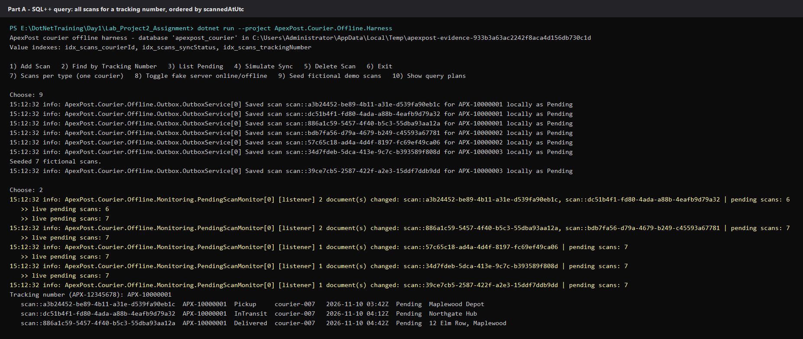
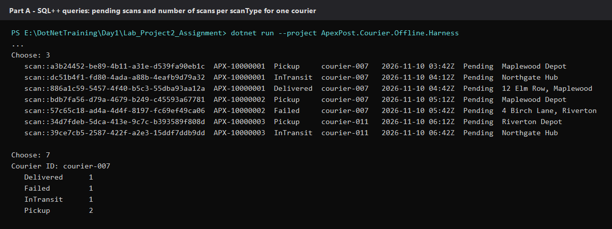
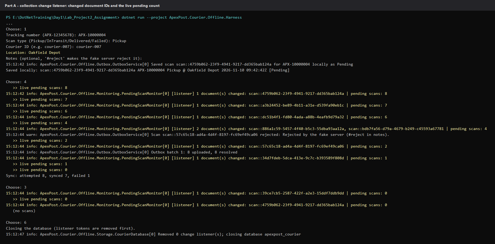
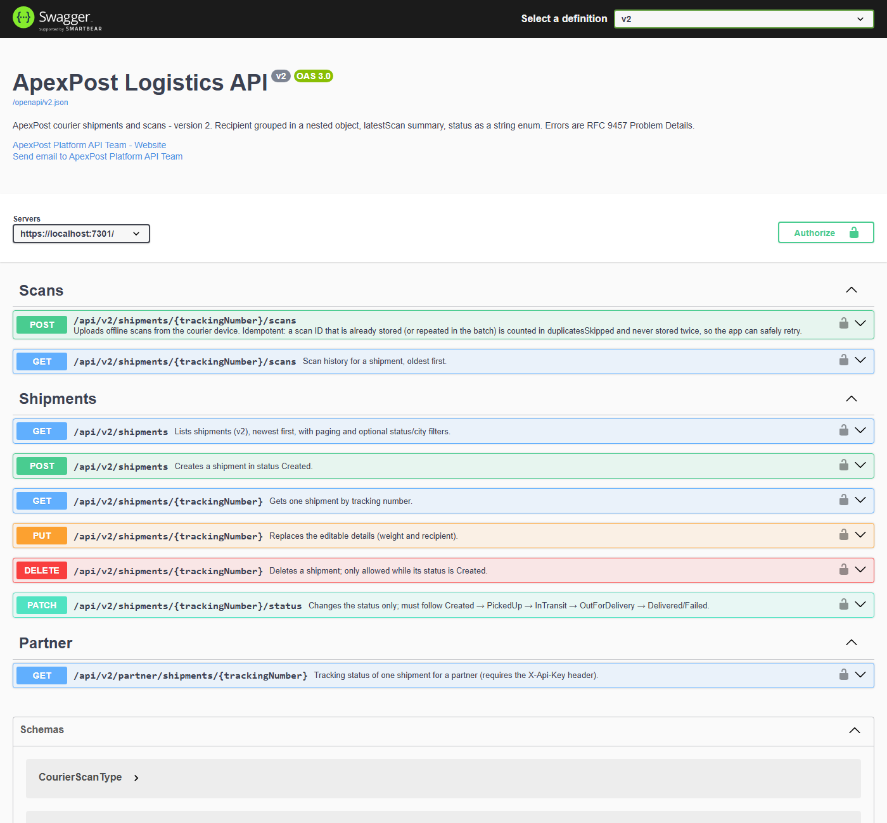
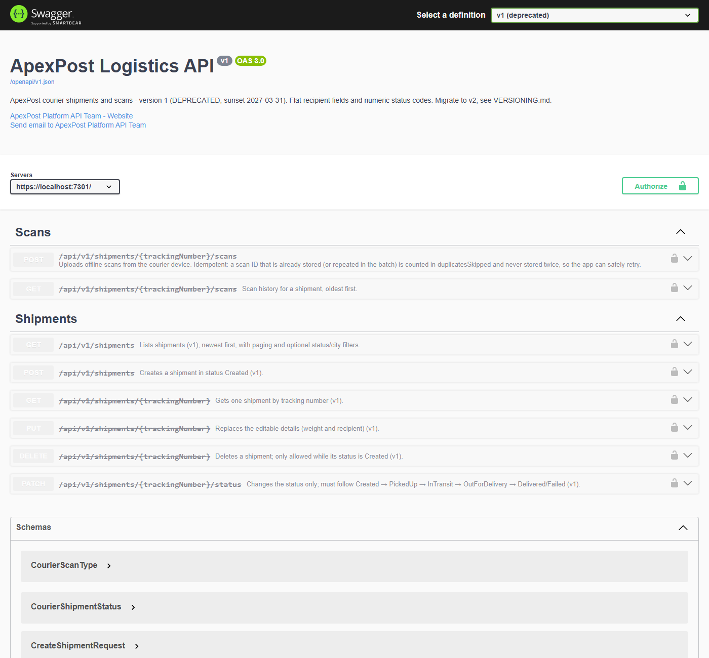
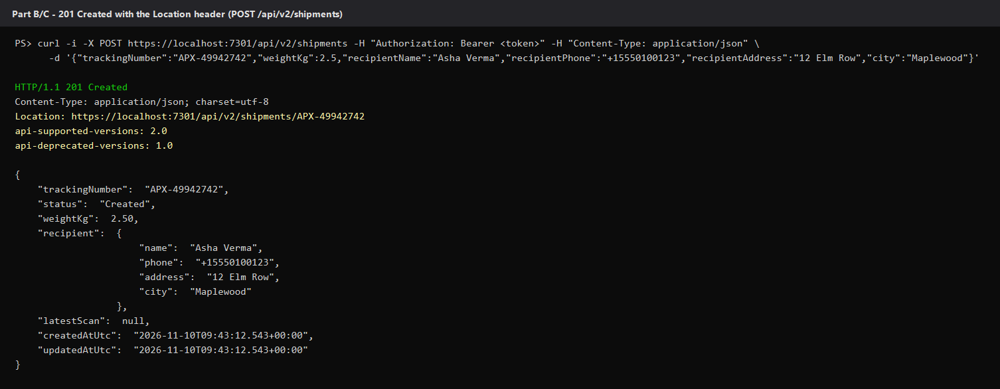
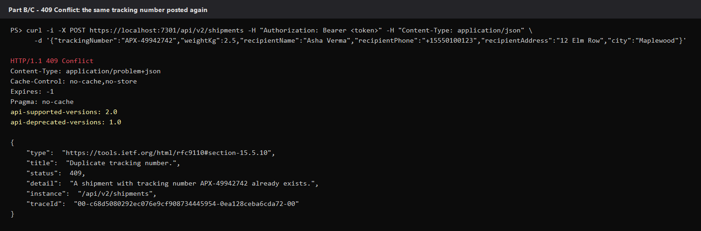
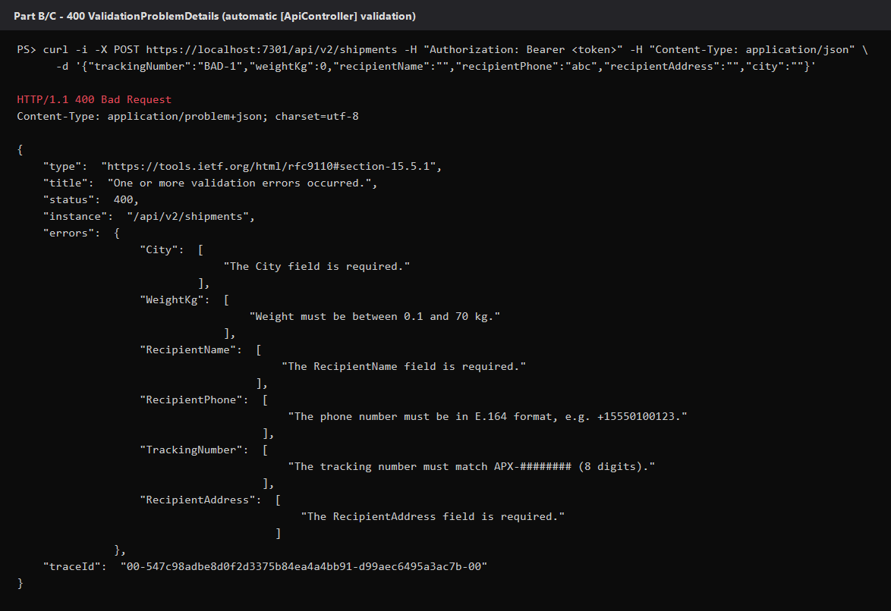

# Week 4 screenshots

Captured on a local machine with `scripts/capture-screenshots.ps1` (fictional data only). Part A images are the real
output of the console harness on a fresh Couchbase Lite database. The Swagger UI images are headless Microsoft Edge
screenshots. The HTTP images are the real responses from `ApexPost.Api` running in Development; the bearer token is
shown as `<token>` and never saved.

## Part A - Couchbase Lite offline store

**All scans for a tracking number, ordered by `scannedAtUtc` (SQL++ with `$trackingNumber`)**



**Pending scans, and the number of scans per scan type for one courier**



**Change listener: changed document IDs and the live pending count while a scan is added and synced**



## Parts B and C - API and Swagger UI

**Swagger UI - "v2" and "v1 (deprecated)" in the definition dropdown**





**201 Created with the `Location` header and the API version headers**



**409 Conflict - the same tracking number posted again (Problem Details)**



**400 Bad Request - `ValidationProblemDetails` from automatic `[ApiController]` validation**



## Reproducing

```powershell
powershell -ExecutionPolicy Bypass -File scripts\capture-screenshots.ps1
```

The same behaviour is covered by the automated tests (`dotnet test ApexPost.Server.slnf`): `CouchbaseScanRepositoryTests`,
`ChangeListenerTests`, `OpenApiDocumentTests`, `ShipmentsApiTests` and `VersioningApiTests`. The 401, 403 and partner API
key requests are in the "SECURITY" section of `ApexPost.Api/ApexPost.Api.http` (`SecurityApiTests`).
