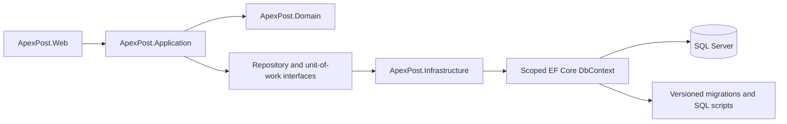
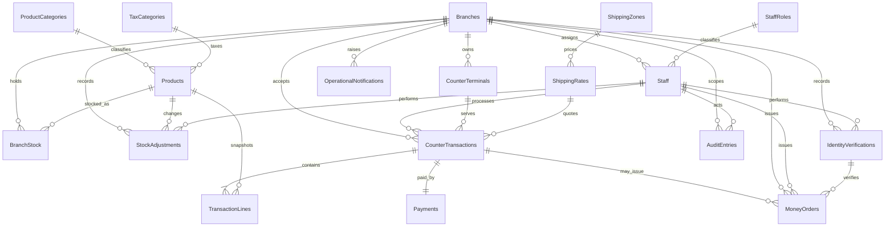

# Week 3 SQL Server persistence

This page records the Week 3 persistence design. Couchbase is outside this assignment scope. The SQL Server model is being introduced behind Infrastructure; existing JSON services remain the active application store until their repositories and checkout unit of work are moved in the next feature slices.

## Dependency and data flow



EF persistence rows are mutable database shapes kept in Infrastructure. Application services continue to work with the immutable Domain records. The EF repositories will map between those shapes and return application DTOs; they will not expose `IQueryable` or track entities outside a request scope. The current application workflows still use the JSON adapters while those repository slices are implemented.

## Relational model



`IdentityVerifications` is its own table. It contains the document type and masked identifier only; there is no full document-number column. Historical receipt lines snapshot SKU, name, unit price, quantity, tax category, and tax rate so later catalogue edits do not rewrite receipts. Branch stock uses a composite `(BranchId, ProductId)` key. Receipt lines and their payment are owned by the receipt; deletes of branches, staff, products, rates, and other historical references are restricted.

Money values use `decimal(18,2)`, weights and dimensions use fixed precision, event times use `datetimeoffset(3)`, and branch hours use SQL `time`. Check constraints repeat important invariants at the storage boundary, including non-negative stock, positive prices/quantities, receipt totals, and required reversal details. Unique indexes cover branch codes, email, SKU, terminal code within a branch, transaction number, money-order number, and one payment per receipt.

`BranchStock.RowVersion` and `CounterTransactions.RowVersion` are SQL Server `rowversion` concurrency tokens. A stale checkout or adjustment will receive an EF concurrency failure that the application layer will translate to a conflict response. The scoped unit of work is implemented to save tracked changes inside a serializable EF transaction. The existing JSON checkout remains active until the application is switched to the EF repositories.

Each mutable table carries created/updated UTC timestamps, actor IDs, and a correlation ID. Audit records are append-only and store safe details only. Outbox messages persist event payloads for retryable notification/synchronization work; processing status and attempts are separate from the business transaction.

## Migrations and stored procedures

The initial model migration lives in `ApexPost.Infrastructure/Persistence/Migrations`. `scripts/database/initial-schema.sql` is an idempotent SQL Server deployment script generated from that migration. Run the scripts in this order:

1. `scripts/database/initial-schema.sql`
2. `scripts/database/reference-data.sql`
3. `scripts/database/stored-procedures.sql`

The reference-data script is repeatable and creates the supported staff roles, product categories, and tax categories. Stored procedures use parameters; stock adjustment uses a transaction and locks its target stock row while checking the non-negative rule. The EF tool factory reads `ConnectionStrings__ApexPost` or `APEXPOST_SQLSERVER` from the environment and otherwise uses LocalDB for design-time model generation. No credentials are committed.

Useful commands:

```powershell
$env:APEXPOST_SQLSERVER = 'Server=localhost;Database=ApexPostCounter;Trusted_Connection=True;TrustServerCertificate=True;MultipleActiveResultSets=true'
dotnet ef migrations add <MigrationName> --context ApexPostDbContext --project ApexPost.Infrastructure --startup-project ApexPost.Infrastructure --output-dir Persistence/Migrations
dotnet ef migrations script --idempotent --context ApexPostDbContext --project ApexPost.Infrastructure --startup-project ApexPost.Infrastructure --output scripts/database/initial-schema.sql
```

The generated migration and script have been checked from EF model metadata. Applying them and measuring query plans requires a reachable SQL Server instance; no database was reachable in this environment, so no execution-time or IO numbers are claimed here.
